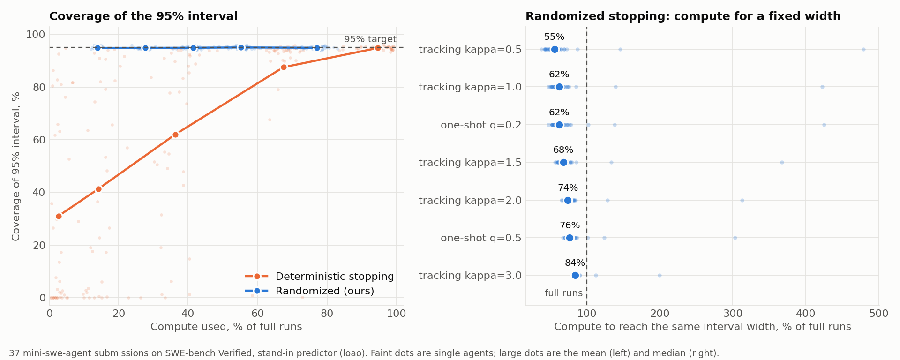

# coverage (Vedanti)

The finding, the estimator, and the confidence intervals.

- Data: SWE-bench Verified submissions (many agents, same tasks)
- Stand-in: simple predictor (logistic regression on step count and test-run features)
- Done when: coverage and cost plots are made with the stand-in predictor

## Run it

From the repo root, with the environment active:

```bash
python coverage/download_swebench.py     # about 30 minutes, 13 GB streamed, 410 MB kept
python coverage/features.py              # about 4 minutes
python coverage/standin_predictor.py     # add --split temporal for the second split
python coverage/experiments.py           # same flag
python coverage/plots.py                 # same flag
python coverage/optimal_policy.py        # about 1 minute
python coverage/adaptive.py --floor 0.2  # about 5 minutes
```

| File | What it does |
| --- | --- |
| `download_swebench.py` | Streams mini-swe-agent runs from the public SWE-bench bucket and writes them in the shared trajectory format, one `.jsonl.gz` per agent in `data/swebench_verified/` |
| `features.py` | One row per step prefix: step count, tokens so far, counts of test runs, edits, errors |
| `standin_predictor.py` | Logistic regression that scores each agent without having seen it |
| `stopping.py` | Deterministic stopping, the randomized policies, the estimator and its exact variance |
| `experiments.py` | Coverage and cost of every method, per agent |
| `optimal_policy.py` | Fits four stopping policies on the other agents and compares them |
| `adaptive.py` | Corrects the predictor during the evaluation from the agent's own results |
| `plots.py` | The two-panel headline figure |

## Data

37 agents, 500 tasks each, 786,050 steps. Every agent's resolve rate was checked against
the leaderboard value.

- 17 submissions were left out: 15 have no per-task results in `swe-bench/experiments`,
  2 have results but no trajectories, and `20260226_mini-v2.0.0_gemini-3-pro-high` has
  a per-task file that marks every task unresolved although the leaderboard says 69.6%.
- Cost is `tokens_in + tokens_out` per step. The 13 submissions from before
  mini-swe-agent 1.13 did not log token usage, so theirs is estimated as characters / 4
  (`tokens_estimated` in `manifest.json`).
- A run with no model call is kept as one empty step so it still counts toward the score.

## Setup of the experiment

For each agent the target is its resolve rate on all 500 tasks. A replicate resamples the
tasks with replacement, applies a stopping method, and builds a 95% interval as
mean ± 1.96 sd / √n. Coverage is the share of 2,000 replicates whose interval contains
the target.

- **Deterministic stopping** (the baseline): stop at the first prediction outside
  (lo, hi) and score the run by that prediction.
- **Randomized, tracking**: the probability of reaching step k is kept at
  kappa · sqrt(f(1 − f)), clipped to [0.05, 1] and never increasing. Kappa trades compute
  for variance.
- **Randomized, one-shot**: finish each run with probability q, otherwise use the step-0
  prediction. This is prediction-powered inference with a fixed predictor.
- **Randomized threshold**: at the deterministic rule's trigger, continue with
  probability 0.2 instead of stopping.

Two splits for the predictor: `loao` trains on every other agent, `temporal` trains only
on agents submitted earlier (31 agents have at least 5 earlier ones).

## Results so far

Stand-in predictor, leave-one-agent-out, 37 agents. Full tables are in `results/`.

| Method | Compute used | Mean coverage | Worst agent | Mean abs. bias |
| --- | --- | --- | --- | --- |
| Full runs | 100% | 94.8% | 93.7% | 0.0 pts |
| Deterministic 0.02/0.98 | 95% | 94.8% | 93.3% | 0.1 pts |
| Deterministic 0.05/0.95 | 67% | 87.5% | 0.2% | 1.1 pts |
| Deterministic 0.1/0.9 | 36% | 62.0% | 0.0% | 4.8 pts |
| Deterministic 0.2/0.8 | 14% | 41.3% | 0.0% | 7.9 pts |
| Randomized, tracking (5 settings) | 14% to 77% | 94.9% to 95.0% | 94.0% | 0.1 pts |

- **The finding holds with this predictor.** Deterministic stopping keeps its coverage
  only while it saves almost nothing. At 0.05/0.95 the median bias is 0.6 points, 6 of 37
  agents fall below 90% coverage, and 8 of the 108 agent pairs within 3 points of each
  other swap order. At 0.1/0.9 it is 25 of 37 agents and 28 of 108 pairs.
- **The randomized estimators stay at 95%**: mean coverage is 94.8% to 95.0% for every randomized method, and no single agent falls below 93.4% on either split (full runs: 93.7%).
- **Compute for a fixed interval width**: tracking with kappa = 0.5 needs a median of 55%
  of full-run compute (63% on the temporal split). It is worse than full runs for 2 of
  37 agents, the two weakest (26% and 9% resolve rate, at 1.5x and 4.8x), because the
  predictor expects about 50% for any new agent.



## Follow-up checks

**Smaller task sets.** With 100 tasks per replicate (`experiments.py --tasks 100`), the
randomized methods cover 94.2% to 94.7% on average and full runs cover 94.4%; the worst
single agent is 92.0% against 92.6% for full runs. Lowering the probability floor from
0.05 to 0.01 changes nothing measurable. The normal interval is about as good with
randomized stopping as without it.

**Is the baseline at EarlyEval's operating point?** Their abstract reports 13% to 26% of
steps removed, up to 44% of input tokens, and resolve rates shifting 1 to 2 points on
average. Deterministic 0.05/0.95 here saves 33% of tokens with a 1.1 point mean shift, so
it sits in the same region, and that is the row where coverage is 87.5%. Their classifier
(paired LightGBM models with reference-solution features) is stronger than this stand-in,
so this is a matched operating point, not a reproduction.

**Fitted policies** (`optimal_policy.py`, results in `results/policy_loao.csv`). Each
policy is fitted on the other 36 agents to minimize variance x expected cost, then scored
on the held-out agent. Numbers are compute for a fixed interval width relative to full
runs.

| Policy | Median | Worst agent | Agents worse than full runs | Compute used |
| --- | --- | --- | --- | --- |
| One-shot, q tuned | 55% | 4.9x | 3 | 5% |
| Tracking, kappa tuned | 53% | 5.3x | 2 | 7% |
| Step schedule, optimized | 58% | 4.3x | 2 | 7% |
| Learned tracking, kappa tuned | 52% | 3.9x | 2 | 7% |

- All four land between 52% and 58%. With this predictor the best policy is close to
  "finish about 1 run in 15 and use the step-0 prediction for the rest": per-step
  stopping adds about 3 points over one-shot.
- One-shot and learned tracking tune to the lowest setting allowed by the 0.05 floor, so
  the floor, not the policy shape, is what binds.
- The gain from stopping inside a run therefore depends on a predictor whose estimate
  moves during the run. That is the learned predictor's job; this stand-in mostly knows
  task difficulty.
- No fitted policy fixes the two weak agents. Their cost comes from the step-0 prediction
  being far from the agent's true rate, which a policy fitted on other agents cannot see.

**Correcting the predictor during the evaluation** (`adaptive.py`). Tasks are evaluated
in batches of 25. Before each batch, all predictions are shifted on the logit scale so
that the step-0 predictions on tasks seen so far average to the current estimate of the
agent's score. The shift uses only earlier batches, so the estimate stays unbiased
(largest bias over 37 agents: 0.6 points). Tracking policy with kappa = 0.25:

| Floor on reach probability | Method | Median compute | Worst agent | Mean coverage | Worst coverage |
| --- | --- | --- | --- | --- | --- |
| 0.05 | static | 52% | 5.6x | 94.5% | 91.9% |
| 0.05 | adaptive | 56% | 1.2x | 92.4% | 86.2% |
| 0.1 | static | 57% | 5.2x | 94.7% | 92.6% |
| 0.1 | adaptive | 53% | 1.3x | 93.7% | 91.6% |
| 0.2 | static | 61% | 4.0x | 94.9% | 91.6% |
| 0.2 | adaptive | 56% | 1.2x | 94.3% | 91.6% |

- **It fixes the weak agents.** The worst case drops from 4 to 5.6 times full-run compute
  to about 1.2 times, and only one agent (9% resolve rate) is still above full runs.
- **It costs coverage unless the floor is raised.** At floor 0.05 the intervals cover
  92.4% on average and 86% for the weakest agent. The estimate is unbiased, so my reading
  is that the interval is too narrow: once the corrected predictor is confident, few runs
  are finished and a handful of heavily weighted ones carry the variance. I have not
  verified that cause directly.
- **Floor 0.2 with correction is the best setting so far**: 56% median compute, 1.2x worst
  case, 94.3% coverage. A 0.6 point gap to the static method remains.
- Compute here is measured from the spread of simulated estimates (800 replicates at
  floor 0.05, 500 at the others), so each number carries a few percent of noise.

**Where the learned tracking rule comes from.** For one run, the variance added by
stopping is Σ_k D_k / P_k with D_k = (Y − f_{k−1})² − (Y − f_k)², and the expected cost is
Σ_k c_k P_k. Suppose that from step k on the reach probability is held at one value P.
The D_k from k onward sum to (Y − f_{k−1})², so the trade-off is (Y − f_{k−1})² / P +
λ · (remaining cost) · P, minimized at P = sqrt(E[(Y − f_{k−1})²] / (λ E[remaining cost])).
Learned tracking applies this at every step with both expectations measured on training
agents, and takes the running minimum. It is therefore the best policy among those that
plan to hold the probability constant from now on, re-planned at each step. The full
optimum may also plan future decreases, so it can only continue at least as often.

## What this does not show yet

- The step schedule is a numerical optimum over step number only, and the two tracking
  rules come from the one-shot optimum q ∝ sqrt(squared error / remaining cost) applied
  at every step. A policy that is optimal over the full state is still not derived.
  `stopping.exact_moments` gives the variance and expected cost it needs:
  Var = Σ_k [(Y − f_{k−1})² − (Y − f_k)²] / P(reach k) − (Y − f_0)².
- The adaptive correction still leaves a small coverage gap, and the interval under it
  needs a martingale argument rather than the independent-tasks one.
- Intervals are plain normal intervals with no proof behind them yet.
- Leave-one-agent-out keeps other versions of the same model in training, and policy
  tables are built from predictions whose models saw the held-out agent.
